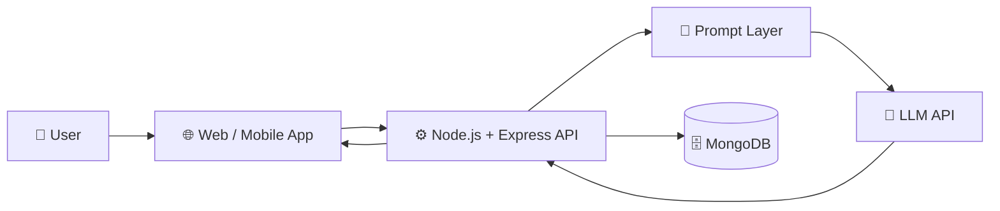

<div align="center">
  
</div>

<div align="center">
  <a href="https://github.com/likon16">
    
  </a>
</div>

<br/>

<div align="center">
  
  
  
  
</div>

<br/>

<div align="center">
  <a href="mailto:mrlikhonbarman@gmail.com"></a>
  <a href="tel:+919883130638"></a>
  <a href="https://wa.me/919883130638"></a>
</div>


## 🧑‍💻 About Me

<table>
<tr>
<td width="58%">

```js
const likhon = {
  name: "Likhon Barman",
  role: "Full-Stack Developer",
  experience: "1+ year",
  location: "West Bengal, India 🇮🇳",
  builds: ["Web Apps", "Mobile Apps", "REST APIs", "AI-powered Systems"],
  stack: ["JavaScript", "Node.js", "Express", "MongoDB", "React"],
  ai: ["Prompt Engineering", "LLM API Integration", "AI Chatbots", "Automation"],
  currentlyLearning: ["TypeScript", "Next.js", "RAG & AI Agents"],
  mindset: "Ship fast. Write clean. Keep learning.",
  available: true,
};
```

</td>
<td width="42%" valign="top">

### ⚡ What I do
- 🌐 Build responsive, modern **web applications**
- 📱 Develop **cross-platform mobile apps**
- 🔌 Design secure **REST APIs & auth systems**
- 🤖 Integrate **AI / LLM APIs** into real systems
- 🧠 Craft effective **prompts** for reliable AI output
- 🗄️ Model data with **MongoDB / SQL**
- ☁️ Deploy and maintain apps in production

</td>
</tr>
</table>


## 🛠️ Tech Arsenal

<div align="center">

**Frontend**


**Backend**


**Mobile & Tools**


</div>

**AI & Prompt Engineering**


</div>

> ✏️ Remove any icon you don't use so the profile stays 100% honest. Full list at [skillicons.dev](https://skillicons.dev).

<div align="center">


## 🤖 AI Integration & Prompt Engineering

<table>
  <tr>
    <td align="center" width="33%">
      <h3>🧠 Prompt Engineering</h3>
      Writing clear, structured prompts, system instructions and few-shot examples for consistent, high-quality AI output.
    </td>
    <td align="center" width="33%">
      <h3>🔌 AI in Systems</h3>
      Connecting LLM APIs to web and mobile apps: chatbots, smart search, content generation and workflow automation.
    </td>
    <td align="center" width="33%">
      <h3>⚙️ Production Ready</h3>
      Backend routes, API key security, error handling and streaming responses so AI features work reliably for users.
    </td>
  </tr>
</table>




## 🧭 Journey

| 🗓️ When | 🚀 Milestone |
|---|---|
| **Started** | Learned HTML, CSS & JavaScript, built Tic-Tac-Toe and a Password Generator |
| **Growing** | Built dynamic apps with Node.js, Express, EJS and MongoDB |
| **Today** | 1+ year as a full-stack developer, shipping web and mobile applications with AI integration |
| **Next** | TypeScript, Next.js, RAG, AI agents and scalable cloud deployments |


## 🚀 Featured Projects

<table>
  <tr>
    <td width="50%" align="center">
      <a href="https://github.com/likon16/Snapgram"></a>
    </td>
    <td width="50%" align="center">
      <a href="https://github.com/likon16/Wonderlust"></a>
    </td>
  </tr>
  <tr>
    <td width="50%" align="center">
      <a href="https://github.com/likon16/Zerodha"></a>
    </td>
    <td width="50%" align="center">
      <a href="https://github.com/likon16/Weather-App"></a>
    </td>
  </tr>
  <tr>
    <td width="50%" align="center">
      <a href="https://github.com/likon16/Tic-Tac-Toe-Game"></a>
    </td>
    <td width="50%" align="center">
      <a href="https://github.com/likon16/password_generator"></a>
    </td>
  </tr>
</table>


## 📊 GitHub Analytics

<div align="center">
  
  
</div>

<div align="center">
  
</div>

<div align="center">
  
</div>


## 🐍 Contribution Snake

<div align="center">
  <picture>
    <source media="(prefers-color-scheme: dark)" srcset="https://raw.githubusercontent.com/likon16/likon16/output/github-snake-dark.svg" />
    <source media="(prefers-color-scheme: light)" srcset="https://raw.githubusercontent.com/likon16/likon16/output/github-snake.svg" />
    
  </picture>
</div>


## 🤝 Let's Build Something Together

<div align="center">

**Need a website, web app, mobile app or AI-powered feature? Let's talk.** 💬

<a href="mailto:mrlikhonbarman@gmail.com"></a>
<a href="https://wa.me/919883130638"></a>
<a href="https://github.com/likon16"></a>

<br/><br/>


</div>


